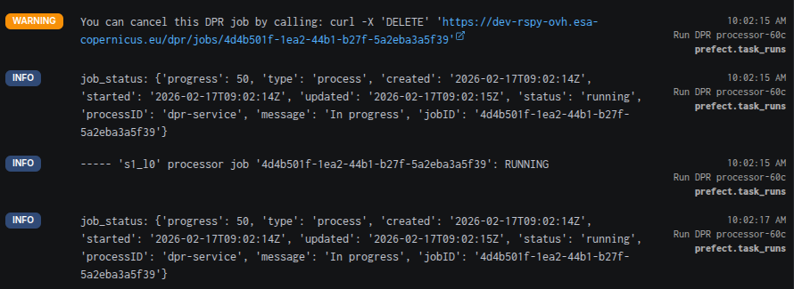
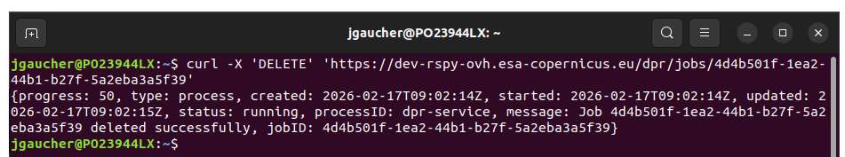
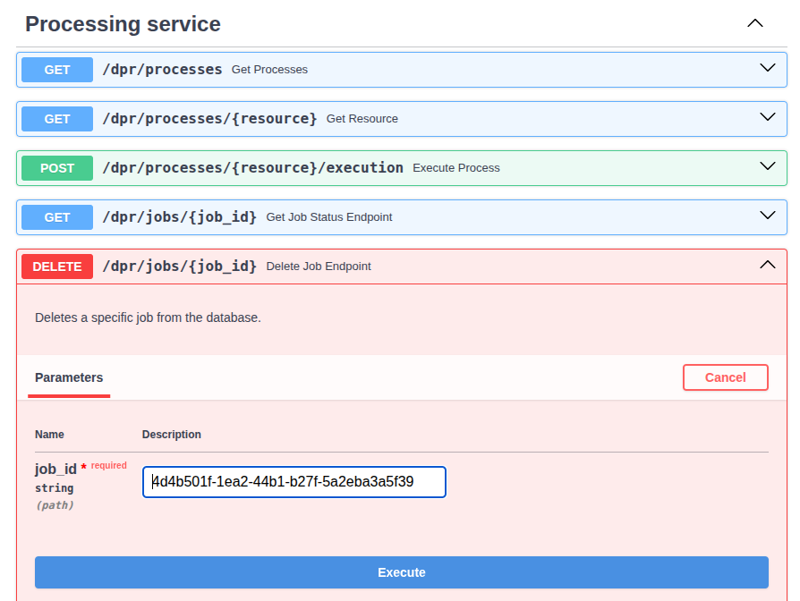

# Cancel a DPR run

A DPR processor run can last several hours. To stop it, cancel the processor job in rs-dpr-service: this stops the
processor on the Dask cluster and makes the Prefect flow run fail.

After triggering a run of the processor, go to the Prefect flow run page: the logs show the command to cancel the
DPR job:



Copy and paste it in any terminal (it uses your API key):



The flow will be cancelled. The Prefect logs will show:

```
# ...
Force termination of EOPF job: '4d4b501f-1ea2-44b1-b27f-5a2eba3a5f39'
# ...
RuntimeError: 's1_l0' processor job '4d4b501f-1ea2-44b1-b27f-5a2eba3a5f39': NOT FOUND
# ...
Finished in state Failed("Task run encountered an exception RuntimeError: Exception while monitoring job 's1_l0' processor:
{
  'type': 'https://developer.mozilla.org/en/docs/Web/HTTP/Reference/Status/404',
  'status': 404,
  'detail': 'Job with ID 4d4b501f-1ea2-44b1-b27f-5a2eba3a5f39 not found'
}
# ...
Process for flow run 'upbeat-avocet' exited with status code: 1
```

Instead of the `curl` command, you can also use the [Swagger page](https://rspy.ops.rs-python.eu/docs#/Processing%20service): enter the job identifier in the `DELETE /dpr/jobs/{job_id}` endpoint:



Be careful to enter the identifier of the DPR job: the Prefect logs contain other job identifiers, e.g. those of the staging jobs:
```
job_status: {
  'status': 'running',
  'type': 'process',
  'created': '2026-02-17T09:02:06Z',
  'message': 'Sending tasks to the dask cluster',
  'progress': 0,
  'processID': 'staging',
  'started': '2026-02-17T09:02:06Z',
  'updated': '2026-02-17T09:02:06Z',
  'jobID': '556363bf-c74d-41cf-931d-1972fe8a7b87'
}

----- Staging from 'mockup-station-adgs.processing.svc.cluster.local' job '556363bf-c74d-41cf-931d-1972fe8a7b87': RUNNING
```

If you enter the identifier of a staging job, the staging job is deleted, but the DPR run is not cancelled.

With Python, use `rs_client.get_dpr_client().delete_job("<job id>")`.
