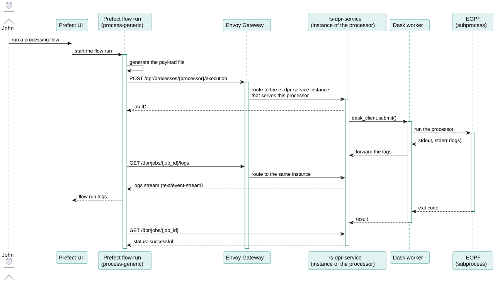
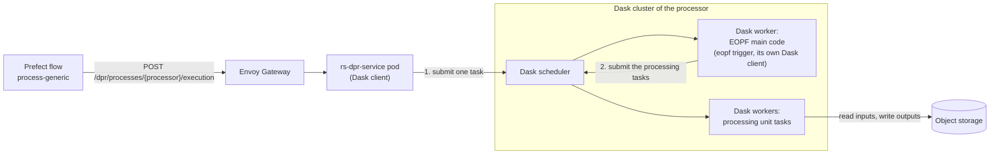

# DPR processors (rs-dpr-service)

Running the **DPR processors** (Data PRocessors) is the main purpose of RS-Python. The DPR processors are the
re-engineered Sentinel-1, Sentinel-2 and Sentinel-3 processors, written in Python by the
[EOPF](https://eopf.copernicus.eu/) (Earth Observation Processing Framework) project of ESA, on top of the
[EOPF Core Python Modules (CPM)](https://cpm.pages.eopf.copernicus.eu/eopf-cpm/main/index.html)
([source code](https://gitlab.eopf.copernicus.eu/cpm/eopf-cpm)). They generate products in the
[Zarr](https://zarr.dev/) format (see the [EOPF sample notebooks](https://github.com/EOPF-Sample-Service/eopf-sample-notebooks)).
They are not part of RS-Python: RS-Python embeds them into Docker images and runs them on its
[Dask](https://www.dask.org/) clusters.

**rs-dpr-service** is the web service that runs the DPR processors. It is not part of the
[rs-server](https://github.com/RS-PYTHON/rs-server) repository because it must use the same Python and Dask
versions as the processors, which are different from those of rs-server: isolating the processing in a dedicated
service avoids library conflicts and Python version incompatibilities.

| | |
|---|---|
| Source code | <https://github.com/RS-PYTHON/rs-dpr-service> |
| Swagger page | [Processing service](https://rspy.ops.rs-python.eu/docs#/Processing%20service) on the reference platform |
| Python API documentation | `rs_dpr_service` module of the [Python API documentation](https://github.com/RS-PYTHON/rs-documentation/blob/develop/docs/developers/python-api.md) |
| Task tables | [config](https://github.com/RS-PYTHON/rs-dpr-service/tree/develop/config) folder |
| Helm chart | [rs-dpr-service chart](https://github.com/RS-PYTHON/rs-helm/blob/develop/charts/rs-dpr-service/README.md) |

## Endpoints

rs-dpr-service follows the [OGC API - Processes](https://ogcapi.ogc.org/processes/) standard, with
[pygeoapi](https://pygeoapi.io/), one process per processor:

| Method | Endpoint | Description |
|---|---|---|
| `GET` | `/dpr/processes` | List the processes: `s1_l0`, `s3_l0`, `s1_ard`, `s3_l1olci`, `s3_l2olci`, `mockup` (a mockup processor for the tests) and `conv_safe_zarr` (conversion of legacy SAFE products to Zarr). |
| `GET` | `/dpr/processes/{processor}` | Get the [task table](https://github.com/RS-PYTHON/rs-client-libraries/blob/develop/docs/doc/flows/tasktable-payload.md) of a processor. |
| `POST` | `/dpr/processes/{processor}/execution` | Run a processor. The request body contains the S3 location of the payload file and of its configuration files, the S3 folder for the processor reports, and the Dask cluster to use (Dask Gateway address and token, cluster label or instance). Returns the job identifier. |
| `GET` | `/dpr/jobs`, `/dpr/jobs/{job_id}` | List the jobs, get the status and progress of a job. |
| `GET` | `/dpr/jobs/{job_id}/logs` | Stream the logs of a job ([server-sent events](https://developer.mozilla.org/en-US/docs/Web/API/Server-sent_events)). |
| `DELETE` | `/dpr/jobs/{job_id}` | Cancel a job, see [Cancel a DPR run](cancel-dpr-run.md). |

In practice, these endpoints are called by the generic processing flow `process-generic` of the
[rs-client-libraries](https://github.com/RS-PYTHON/rs-client-libraries/blob/develop/docs/doc/advanced/customise-dpr-flow.md),
that computes the payload file from the task table and the flow parameters. Calling them directly is mainly useful
to follow or cancel a job.

## How a processor is run

Two kinds of Docker images are involved:

| Image | Content | Role |
|---|---|---|
| `rs-dpr-service_py<python>-<dask>` | The web service. | Receives the requests, connects to the Dask cluster as a client, submits the processor run, stores the jobs in a PostgreSQL database, streams the logs. |
| `dask/<processor>/k8s` | The DPR processor, EOPF CPM and their dependencies, plus the `rs_dpr_service` code sent to the workers. | The scheduler and workers of the Dask cluster of the processor, created through Dask Gateway (see [Dask images](https://github.com/RS-PYTHON/rs-workflow-env/blob/develop/docs/dask_images.md)). |

1. rs-dpr-service connects to the Dask cluster of the processor and submits a single task, that runs the EOPF
   triggering command (`eopf trigger` with the payload file) in a sub-process of a Dask worker, and forwards its
   logs. Before running the command, this task prepares the payload file (see [Payload file](#payload-file)).
2. EOPF reads the payload file and runs the processing units of the processor: it submits their tasks to the same
   Dask cluster, that distributes them on its workers. The workers read the inputs and write the outputs directly
   in the object storage.

In a typical Dask architecture, the main code that submits the tasks runs on the client side, i.e. in the
rs-dpr-service pod. Here it runs on a worker of the Dask cluster, because the EOPF main code needs too many resources
(memory, processor dependencies) to run in the web service.

The task that runs the EOPF main code only waits for its sub-process, so it calls the Dask
[`secede()`](https://distributed.dask.org/en/stable/task-launch.html) function at its start: it leaves the thread pool
of the worker, and all the threads of the worker stay available for the processing tasks. Otherwise, as many
concurrent jobs as threads in the cluster would hold all the threads, and wait forever for their processing tasks.

The cancellation of a job sets a Dask event that makes the worker kill the EOPF sub-process.

### Payload file

The payload files follow the format of EOPF CPM v3. Before triggering the processor, the Dask worker:

- writes the Dask cluster to use in the `context_managers` section of the payload, with the
  `eopf.dask_utils.dask_context_manager.DaskContext` context manager (Dask Gateway address, cluster instance and
  authentication),
- exports the S3 credentials of the input products (`storage_options` of their `reader_params`) as environment
  variables for the processor: `S3_KEY`, `S3_SECRET`, `S3_URL`, `S3_REGION`, and `S3_SECRETS_JSON_BASE64` that
  defines the `s3input` alias. All the input products must use the same credentials,
- validates the payload file with the EOPF `validate-payload` command (`preflight` level), if the EOPF version is
  3.1.0rc1 or later. An invalid payload stops the job before the processing starts.

## SAFE to Zarr conversion

The `conv_safe_zarr` process converts a legacy SAFE product to Zarr with the EOPF `convert` function, on the
`cpm3` Dask cluster (CPM 3.0.0). The conversion runs in a subprocess of a Dask worker
([safe_to_zarr.py](https://github.com/RS-PYTHON/rs-dpr-service/blob/develop/rs_dpr_service/safe_to_zarr.py)): the
SAFE product is downloaded to the worker, converted locally, then the Zarr product is uploaded to the bucket.

### Sentinel-1 SLC products: S1 ARD format

!!! warning "Not compatible with CPM 3.0.0"

    The Sentinel-1 IW and EW SLC products are **not** written in the CPM 3.0.0 format, but in the format expected by
    the S1 ARD processor. These products are NOT compatible with the CPM 3.0.0 Sentinel-1 SLC model.

The S1 ARD processor (s1-ard 1.2.0) runs with CPM 3.0.0rc4, and checks that its SLC inputs have the layout written
by the Sentinel-1 SLC conversion of CPM 2.x: one sub-product per burst **and per polarization**
(e.g. `S01SIWSLC_..._VH_IW1_132825`), with a flat `other_metadata`, a `sar:polarization` STAC property, a
`processing_history` indexed by product level, and `line`/`pixel` coordinates.

Since CPM 3.0.0, the conversion joins both polarizations of each burst along a `polarization` dimension
([CPM issue #1042](https://gitlab.eopf.copernicus.eu/cpm/eopf-cpm/-/issues/1042)), splits `other_metadata` by
polarization, and drops several annotation attributes. Its processing history is also broken: it only contains an
`Unknown` entry, dated 1970, because the CPM parser tests the XML attributes with `"name" in node`, which looks for
child elements with lxml. So S1 ARD rejects the SLC products converted by CPM 3.0.0, for example with
`KeyError: 'Level-1 Intermediate SLC Product'`.

For the Sentinel-1 IW and EW SLC products, the conversion therefore transforms the product read by CPM 3.0.0 before
writing it, without copying the measurement data
([s1_slc_s1ard_format.py](https://github.com/RS-PYTHON/rs-dpr-service/blob/develop/rs_dpr_service/s1_slc_s1ard_format.py)):

- each burst is split into one burst per polarization,
- `other_metadata` is rebuilt from the SAFE annotation files, like CPM 2.x,
- `processing_history` is rebuilt from the SAFE manifest,
- the `sar:polarization` STAC property, the `conditions/burst_info` group and the `line`/`pixel` coordinates of the
  measurements, geolocation grid, calibration and noise groups are added,
- the noise LUTs are read from the SAFE noise files, like CPM 2.x.

CPM 3.0.0 also mixes up the polarizations of the data: with
`S1A_IW_SLC__1SDV_20260421T234638_20260421T234646_064184_08142A_7054`, its `VV` label contains the VH pixels and noise
LUTs (and conversely), and both polarizations have the same `image_number`. So the polarization of the measurements of
each burst is found by comparing a small window of pixels with the measurement TIFF file of each polarization (a
warning is logged when the CPM labels are wrong), and the image number is read from the annotation file.

With the IW1 swath of this real product, the result is identical to the conversion by CPM 2.8.1 (including the
measurement pixels), except for the image number fixed above and the metadata specific to CPM 3.0.0 (e.g. its
processing history entry). The whole product passes the input checks of the S1 ARD processor.

The converted product is identified by these STAC properties, at its root and in each burst, so they are also in its
catalog item:

| Property | Value |
|---|---|
| `rspy:product_format` | `s1ard-1.2.0` |
| `rspy:product_format_cpm_compatible` | `3.0.0rc4` |
| `rspy:product_format_cpm_incompatible` | `3.0.0` |
| `rspy:product_format_cpm_issue` | <https://gitlab.eopf.copernicus.eu/cpm/eopf-cpm/-/issues/1042> |
| `rspy:product_format_description` | Explanation of the incompatibility |

The conversion result also contains a `warning` with this explanation, which is written in the flow logs.

The other annotation files of CPM 2.x that S1 ARD doesn't use (`other_metadata_rfi`) are not rebuilt.

## Task tables

The task tables of the [config](https://github.com/RS-PYTHON/rs-dpr-service/tree/develop/config) folder follow the
EOPF CPM v3 format: their `io` section is split into `input`, `adfs` and `output` lists, each product defining its
`engine` (e.g. `cpm_zarr`, `cpm_safe`) and its `reader_params` or `writer_params`. They are all validated by the CI
against the JSON schema [schemas/TaskTable.schema.json](https://github.com/RS-PYTHON/rs-dpr-service/blob/develop/schemas/TaskTable.schema.json),
referenced by their `$schema` property.

## Deployment

A Dask client must use the same Python and Dask versions as the Dask cluster it connects to. As the processors don't
all use the same versions, rs-dpr-service is built and deployed once per Python and Dask version
(`rs-dpr-service-py-<python>-dask-<dask>` applications of
[rs-server-deployment](https://github.com/RS-PYTHON/rs-server-deployment/blob/develop/README.md)). Each instance serves
the `/dpr/processes/<processor>` routes of the processors that use its versions, and the Envoy Gateway routes the
requests to the right instance. The list of the Python and Dask versions used is given in the
[dask-cluster-versions.yml](https://github.com/RS-PYTHON/rs-workflow-env/blob/develop/docker/scripts/dask-cluster-versions.yml)
file of rs-workflow-env.

## Experimental configurations

For tests and debugging, the request body can contain an `experimental_config` section (see
[settings.py](https://github.com/RS-PYTHON/rs-dpr-service/blob/develop/rs_dpr_service/utils/settings.py)):

- `local_cluster`: run the processor with a Dask `LocalCluster` created by EOPF inside a single worker of the Dask
  cluster (or, in local mode, inside the `ghcr.io/rs-python/dask/<processor>/localcluster` container, which contains
  both rs-dpr-service and the processor and allows to put breakpoints in the EOPF and processor code). By default,
  the `LocalCluster` has one worker per CPU, with 10 GiB of memory and a single thread per worker. It can also be
  enabled for all the jobs with the `DPR_LOCAL_CLUSTER=true` environment variable of rs-dpr-service,
- `local_files`: with a `LocalCluster`, download the inputs from the object storage to a local folder, run the
  processor on the local files, then upload the outputs.

## Integrate a new processor

See [DPR processor integration](processor-integration.md).
