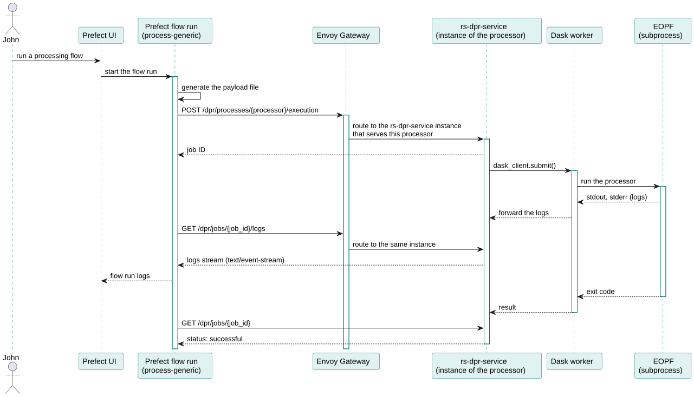
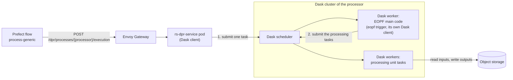

# DPR processors (rs-dpr-service)

Running the **DPR processors** (Data PRocessors) is the main purpose of RS-Python. The DPR processors are the
re-engineered Sentinel-1, Sentinel-2 and Sentinel-3 processors, written in Python by the
[EOPF](https://eopf.copernicus.eu/) (Earth Observation Processing Framework) project of ESA, on top of the
[EOPF Core Python Modules (CPM)](https://cpm.pages.eopf.copernicus.eu/eopf-cpm/main/index.html)
([source code](https://gitlab.eopf.copernicus.eu/cpm/eopf-cpm)). They generate products in the
[Zarr](https://zarr.dev/) format (see the [EOPF sample notebooks](https://github.com/EOPF-Sample-Service/eopf-sample-notebooks)).
They are not part of RS-Python: RS-Python embeds them into Docker images and runs them on its
[Dask](https://www.dask.org/) clusters.

**rs-dpr-service** is the web service that runs the DPR processors. It is not part of the
[rs-server](https://github.com/RS-PYTHON/rs-server) repository because it must use the same Python and Dask
versions as the processors, which are different from those of rs-server: isolating the processing in a dedicated
service avoids library conflicts and Python version incompatibilities.

| | |
|---|---|
| Source code | <https://github.com/RS-PYTHON/rs-dpr-service> |
| Swagger page | [Processing service](https://rspy.ops.rs-python.eu/docs#/Processing%20service) on the reference platform |
| Python API documentation | `rs_dpr_service` module of the [Python API documentation](https://github.com/RS-PYTHON/rs-documentation/blob/develop/docs/developers/python-api.md) |
| Task tables | [config](https://github.com/RS-PYTHON/rs-dpr-service/tree/develop/config) folder |
| Helm chart | [rs-dpr-service chart](https://github.com/RS-PYTHON/rs-helm/blob/develop/charts/rs-dpr-service/README.md) |

## Endpoints

rs-dpr-service follows the [OGC API - Processes](https://ogcapi.ogc.org/processes/) standard, with
[pygeoapi](https://pygeoapi.io/), one process per processor:

| Method | Endpoint | Description |
|---|---|---|
| `GET` | `/dpr/processes` | List the processes: `s1_l0`, `s3_l0`, `s1_ard`, `s3_l1olci`, `s3_l2olci`, `mockup` (a mockup processor for the tests) and `conv_safe_zarr` (conversion of legacy SAFE products to Zarr). |
| `GET` | `/dpr/processes/{processor}` | Get the [task table](https://github.com/RS-PYTHON/rs-client-libraries/blob/develop/docs/doc/flows/tasktable-payload.md) of a processor. |
| `POST` | `/dpr/processes/{processor}/execution` | Run a processor. The request body contains the S3 location of the payload file and of its configuration files, the S3 folder for the processor reports, and the Dask cluster to use (Dask Gateway address and token, cluster label or instance). Returns the job identifier. |
| `GET` | `/dpr/jobs`, `/dpr/jobs/{job_id}` | List the jobs, get the status and progress of a job. |
| `GET` | `/dpr/jobs/{job_id}/logs` | Stream the logs of a job ([server-sent events](https://developer.mozilla.org/en-US/docs/Web/API/Server-sent_events)). |
| `DELETE` | `/dpr/jobs/{job_id}` | Cancel a job, see [Cancel a DPR run](cancel-dpr-run.md). |

In practice, these endpoints are called by the generic processing flow `process-generic` of the
[rs-client-libraries](https://github.com/RS-PYTHON/rs-client-libraries/blob/develop/docs/doc/advanced/customise-dpr-flow.md),
that computes the payload file from the task table and the flow parameters. Calling them directly is mainly useful
to follow or cancel a job.

## How a processor is run

Two kinds of Docker images are involved:

| Image | Content | Role |
|---|---|---|
| `rs-dpr-service_py<python>-<dask>` | The web service. | Receives the requests, connects to the Dask cluster as a client, submits the processor run, stores the jobs in a PostgreSQL database, streams the logs. |
| `dask/<processor>/k8s` | The DPR processor, EOPF CPM and their dependencies, plus the `rs_dpr_service` code sent to the workers. | The scheduler and workers of the Dask cluster of the processor, created through Dask Gateway (see [Dask images](https://github.com/RS-PYTHON/rs-workflow-env/blob/develop/docs/dask_images.md)). |

1. rs-dpr-service connects to the Dask cluster of the processor and submits a single task, that runs the EOPF
   triggering command (`eopf trigger` with the payload file) in a sub-process of a Dask worker, and forwards its
   logs.
2. EOPF reads the payload file and runs the processing units of the processor: it submits their tasks to the same
   Dask cluster, that distributes them on its workers. The workers read the inputs and write the outputs directly
   in the object storage.

In a typical Dask architecture, the main code that submits the tasks runs on the client side, i.e. in the
rs-dpr-service pod. Here it runs on a worker of the Dask cluster, because the EOPF main code needs too many resources
(memory, processor dependencies) to run in the web service.

The cancellation of a job sets a Dask event that makes the worker kill the EOPF sub-process.

## Deployment

A Dask client must use the same Python and Dask versions as the Dask cluster it connects to. As the processors don't
all use the same versions, rs-dpr-service is built and deployed once per Python and Dask version
(`rs-dpr-service-py-<python>-dask-<dask>` applications of
[rs-server-deployment](https://github.com/RS-PYTHON/rs-server-deployment/blob/develop/README.md)). Each instance serves
the `/dpr/processes/<processor>` routes of the processors that use its versions, and the Envoy Gateway routes the
requests to the right instance. The list of the Python and Dask versions used is given in the
[dask-cluster-versions.yml](https://github.com/RS-PYTHON/rs-workflow-env/blob/develop/docker/scripts/dask-cluster-versions.yml)
file of rs-workflow-env.

## Experimental configurations

For tests and debugging, the request body can contain an `experimental_config` section (see
[settings.py](https://github.com/RS-PYTHON/rs-dpr-service/blob/develop/rs_dpr_service/utils/settings.py)):

- `local_cluster`: run the processor with a Dask `LocalCluster` created by EOPF inside a single worker of the Dask
  cluster (or, in local mode, inside the rs-dpr-service container, which allows to put breakpoints in the EOPF and
  processor code),
- `local_files`: with a `LocalCluster`, download the inputs from the object storage to a local folder, run the
  processor on the local files, then upload the outputs.

## Integrate a new processor

See [DPR processor integration](processor-integration.md).
